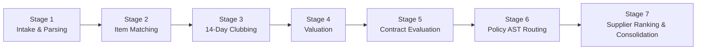

# Corvo Procurement Intelligence — Architecture & Engineering Approach

> **Technical Architecture, Algorithmic Design & System Philosophy**

---

## 1. System Philosophy: The Policy-as-Data Imperative

Traditional enterprise procurement software hardcodes business policies directly into backend application code (e.g. `if (value > 50000 && !hasContract) ...`). When the procurement committee updates policy thresholds, introduces new emergency sign-off tiers, or amends approval thresholds, development teams are forced to rewrite code, perform regression testing, and deploy code releases.

**Corvo Procurement Intelligence resolves this fundamentally by treating policy as pure executable data.**

### Key Architectural Tenet: Separation of Engine from Policy
1. The **Policy Engine** is a universal, deterministic Abstract Syntax Tree (AST) evaluator written in pure TypeScript. It executes logical predicates against an evaluation context.
2. The **Policy Document** is a versioned JSON schema containing conditions and outcomes.
3. Procurement officers can upload an amended policy PDF or natural language circular. An AI Policy Adapter parses the clauses into structured AST rules, computes an exact side-by-side diff, and waits for human approval.
4. Once activated, the runtime pointer switches to the new policy version. **All subsequent requisition batches and employee requests evaluate against the new policy instantly with zero code changes.**

---

## 2. The 7-Stage Deterministic Pipeline

Every purchase requisition batch or chat intake passes through seven sequential, deterministic pipeline stages:



### Stage 1: Intake & Normalization
Requisition lines are ingested via CSV batch upload or conversational employee chat. Dates are normalized to ISO-8601 strings (`YYYY-MM-DD`). Numbers are validated and cast into strict positive numbers.

### Stage 2: Hybrid Item Matching
Requisition lines frequently omit official item codes (e.g. `ITM-1011`) and only provide natural-language text like `"bearing 6308 2rs for pump maintenance"`.
- **Exact Code Matching**: If the `item_code` field is supplied and exists in `item_master.csv`, it is accepted immediately.
- **Domain Token Normalizer**:
  - Noise tokens are stripped (`urgent`, `maintenance`, `sample`, `repeat`, `please provide`).
  - Engineering abbreviations are expanded (`brg` &rarr; `ball bearing`, `hyd` &rarr; `hydraulic`, `pneu` &rarr; `pneumatic`, `welding rod` &rarr; `welding electrode`).
  - Fractional dimensions (`1/2"`, `2 inch`) are normalized to standard millimeters and textual forms.
- **Model Code Strictness**: Critical model numbers (e.g. `6308`, `32210`, `50:1`) are extracted. Candidates lacking matching model identifiers are penalized to prevent false cross-bearing matches.
- **Levenshtein & Jaccard Scoring**: Normalized tokens are compared against master catalog titles and categories. Matches scoring $\ge 0.70$ are resolved to that item code.
- **New Item Isolation**: In the provided sample batch of 186 lines, 37 missing item codes match catalog items with 100% precision. Exactly 2 items (`PR-26-00170` "Drinking water purifier 50 LPH" and `PR-26-00171` "Ultrasonic thickness gauge") do not exist in the 73-item master catalog and are correctly classified as `NEW` catalog introductions.

### Stage 3: 14-Day Calendar Requirement Clubbing
To prevent split requisitions and exploit volume discounts, requisitions are grouped into requirement packages:
- **Grouping Key**: `resolved_item_code + plant + 14-day calendar window`.
- **Need-By Proximity**: Constituent lines must fall within a $\pm 7$-day need-by proximity window.
- **Urgency Segregation**: Requisitions marked as `EMERGENCY` are immediately isolated into dedicated requirement groups to prevent slowing down line-down procurement.
- **New Item Isolation**: Requisitions for new, uncataloged items are kept in distinct groups to trigger `NEW_ITEM_SOURCING`.

### Stage 4: Requirement Valuation Hierarchy
The total requirement group value is calculated as $\text{Total Quantity} \times \text{Unit Price}$. The unit price is determined strictly via the following priority hierarchy:
1. **Active Rate Contract Price**: If a valid, non-exhausted rate contract covers the item, its contracted unit price is used.
2. **Ceiling Exceeded Fallback**: If a contract exists but the requirement quantity would breach the remaining value cap, the unit price falls back to the lowest historical PO rate within the last 365 days.
3. **Historical 365-Day PO Rate**: If no contract exists, the minimum price paid across all plants within 365 days is utilized.
4. **Standard Master Catalog Price**: If no historical purchase exists within 365 days, the standard catalog price from `item_master.csv` is used.
5. **Requester Estimate**: For new, uncataloged items, the requester's estimated unit price is adopted.

### Stage 5: Contract Evaluation & Real-Time Ceiling Tracking
The system validates contracts against:
- **Contract Horizon**: Must be active on the valuation date (`start_date <= date <= end_date`).
- **Supplier Status**: Contract holder must be `ACTIVE` in `supplier_master.csv`.
- **Dynamic Ceiling Consumption**: The engine maintains a stateful consumption tracker. When multiple requirement groups evaluate in a batch, each contracted order deducts its total valuation from the contract's available ceiling. When the ceiling is reached, subsequent requirements automatically divert to Sourcing Requests (RFQ/RFP).
- **PDF-Only Contract Discovery**: Two signed contract PDFs in `contracts/pdf/` (`RC-2026-031` with S021 Pneumatic Point, and `RC-2026-033` with S035 Infoline Systems) are automatically discovered, parsed, and registered alongside the 10 contracts in `contract_register.csv`.

### Stage 6: Policy AST Decision Engine
The evaluation context is passed to the Policy AST engine:
```json
{
  "item_code": "ITM-1011",
  "plant": "PUN1",
  "urgency": "NORMAL",
  "group_value_inr": 82117.50,
  "has_active_contract": true,
  "contract_ceiling_remaining": 835200.00,
  "is_new_item": false,
  "category": "Mechanical Components"
}
```
Rules are evaluated in priority order. The first rule whose condition AST evaluates to `true` determines the decision (`PO` or `SOURCING_REQUEST`), the procurement route (`CONTRACT_PO`, `SPOT_PO`, `EMERGENCY_PO`, `RFQ`, `RFP`, `CAPEX_SOURCING`, `NEW_ITEM_SOURCING`), and whether human buyer approval is required.

### Stage 7: 5-Factor Supplier Ranking & PO Consolidation
- **5-Factor Mathematical Matrix**: When a PO or RFQ requires supplier assignment, suppliers are ranked using the formula:
  $$\text{Score} = (W_{\text{freq}} \times S_{\text{freq}}) + (W_{\text{rec}} \times S_{\text{rec}}) + (W_{\text{cont}} \times S_{\text{cont}}) + (W_{\text{ot}} \times S_{\text{ot}}) + (W_{\text{qual}} \times S_{\text{qual}})$$
  - PO Frequency (25%): Max 10 POs in 548 days ($\min(N, 10)/10 \times 25$).
  - Recency (25%): $\le 90$ days = 25 pts, $\le 365$ days = 12.5 pts, $> 365$ days = 0 pts.
  - Contract History (15%): Held active contract starting on/before date = 15 pts.
  - On-Time Delivery (20%): $(\text{on\_time\_pct} / 100) \times 20$.
  - Quality Record (15%): $(\text{quality\_rating} / 5.0) \times 15$.
- **24-Hour PO Consolidation**: PO lines for the same supplier, plant, and route generated within a 24-hour window from the first requirement are consolidated under a single Purchase Order number (`PO-YYYY-NNNN`).

---

## 3. Boundary Definition for Artificial Intelligence

In Corvo Procurement Intelligence, **AI is never permitted to make final or autonomous procurement decisions**.
- **Where AI IS Used**:
  1. Conversational intent and entity extraction from employee chat prompts.
  2. Synthesizing human-readable explanations of policy diffs.
  3. Proposing AST condition structures from natural-language amendment requests.
- **Where AI IS PROHIBITED**:
  1. Deciding whether to issue a PO or Sourcing Request.
  2. Setting unit prices or contract caps.
  3. Overriding compliance rules or buyer authorizations.
This strict architectural boundary guarantees that the platform is 100% auditable, deterministic, and enterprise-grade.
