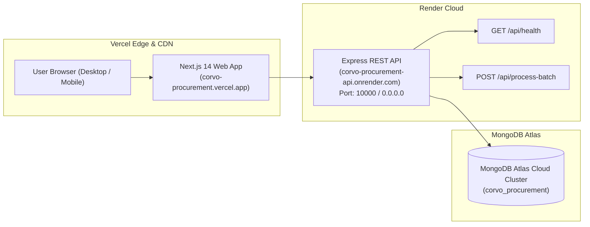

# Corvo Procurement Intelligence — Production Deployment Guide

> **Target Architecture**:
> - **Frontend**: Vercel (Next.js 14 App Router)
> - **Backend**: Render (Express + TypeScript REST API)
> - **Database**: MongoDB Atlas (Cloud Cluster)
> - **GitHub Repository**: `https://github.com/jatinsharma2005/corvo-procurement-intelligence`

---

## 1. Architecture & Hosting Topology



---

## 2. Step-by-Step Deployment Instructions

### STEP 1: MongoDB Atlas Database Setup

1. **Create an Atlas Cluster**:
   - Log into [MongoDB Atlas](https://cloud.mongodb.com).
   - Create a new project or select an existing one.
   - Deploy an **M0 Free Tier** (or dedicated) cluster (recommended cloud provider: AWS, region: closest to Render, e.g. `ap-south-1` or `eu-central-1`).
2. **Create a Database User**:
   - Navigate to **Security** &rarr; **Database Access**.
   - Click **Add New Database User**.
   - Authentication Method: **Password**.
   - Set Username (e.g. `corvo_db_admin`) and a strong, high-entropy password.
   - Built-in Role: **Read and write to any database**.
3. **Configure Network Access**:
   - Navigate to **Security** &rarr; **Network Access**.
   - Click **Add IP Address**.
   - Select **Allow Access From Anywhere** (`0.0.0.0/0`) so that Render server instances and local seed scripts can connect with authentication over TLS.
4. **Obtain Connection String**:
   - Navigate to **Deployment** &rarr; **Database** &rarr; Click **Connect** on your cluster.
   - Select **Drivers** (Node.js).
   - Copy the SRV connection URI:
     ```
     mongodb+srv://<username>:<password>@<cluster-address>.mongodb.net/corvo_procurement?retryWrites=true&w=majority
     ```
   - Replace `<username>` and `<password>` with your database user credentials. Notice the database name `/corvo_procurement`.
5. **Initial Data Seeding (From Local Machine)**:
   - On your local development machine with the supplied task kit files:
     ```bash
     cd corvo-procurement
     # Set MONGODB_URI in your local .env to your Atlas connection string
     pnpm seed
     ```
   - This populates the 2 plants, 73 catalog items, 48 suppliers, 12 contracts (including signed PDFs), 468 PO records, Policy v5.0, and the initial accounts into Atlas.
   - *Automatic seed fallback*: If Atlas is unseeded when Render boots, the server automatically initializes Policy v5.0 and the initial Admin/Buyer users upon cold start.

---

### STEP 2: Render Backend API Deployment

1. **Create Web Service**:
   - Log into [Render Dashboard](https://dashboard.render.com).
   - Click **New +** &rarr; **Web Service**.
   - Connect your GitHub repository: `jatinsharma2005/corvo-procurement-intelligence`.
2. **Service Configuration Settings**:
   - **Name**: `corvo-procurement-api`
   - **Region**: Choose the region closest to your MongoDB Atlas cluster (e.g., Singapore, Frankfurt, or Oregon).
   - **Branch**: `main` (or `master`)
   - **Root Directory**: Leave blank (Defaults to repository root `.`)
   - **Runtime**: `Node`
   - **Build Command**:
     ```bash
     pnpm install && pnpm build:api
     ```
   - **Start Command**:
     ```bash
     pnpm start:api
     ```
   - **Plan**: Free or Starter
3. **Advanced Settings & Health Check**:
   - **Health Check Path**: `/api/health`
   - **Auto-Deploy**: `Yes`
4. **Configure Render Environment Variables**:
   Under **Environment Variables**, add the following:

   | Key | Value / Example | Description |
   | :--- | :--- | :--- |
   | `NODE_ENV` | `production` | Production environment flag |
   | `PORT` | `10000` | Port assigned by Render (Server listens on `0.0.0.0`) |
   | `MONGODB_URI` | `mongodb+srv://...` | MongoDB Atlas SRV connection string |
   | `JWT_SECRET` | *(64-char random string)* | Cryptographically secure 256-bit secret |
   | `JWT_EXPIRES_IN` | `8h` | Token expiration period |
   | `CORS_ORIGIN` | `https://<your-vercel-domain>.vercel.app` | Vercel domain (multiple comma-separated allowed) |
   | `INITIAL_ADMIN_EMAIL` | `admin@corvo.internal` | Provisioned Administrator email |
   | `INITIAL_ADMIN_PASSWORD` | *(Strong Password)* | Initial password for Admin account |
   | `INITIAL_BUYER_EMAIL` | `buyer@corvo.internal` | Provisioned Buyer email |
   | `INITIAL_BUYER_PASSWORD` | *(Strong Password)* | Initial password for Buyer account |
   | `AI_PROVIDER` | `fallback` | Set to `gemini` or `openai` if adding AI API keys |

5. **Deploy Service**:
   - Click **Create Web Service**.
   - Render will build the shared packages, compile `apps/api/dist/server.js`, and launch the service.
   - Note down the generated Render URL (e.g. `https://corvo-procurement-api.onrender.com`).

---

### STEP 3: Vercel Frontend Deployment

1. **Import Project**:
   - Log into [Vercel Dashboard](https://vercel.com).
   - Click **Add New...** &rarr; **Project**.
   - Import your GitHub repository: `jatinsharma2005/corvo-procurement-intelligence`.
2. **Project Settings**:
   - **Framework Preset**: `Next.js`
   - **Root Directory**: Click **Edit** and select:
     ```
     apps/web
     ```
   - **Include files outside of the Root Directory**: Ensure **Checked / Enabled** (required for monorepo shared packages).
3. **Build & Development Settings**:
   - **Build Command**: `pnpm build` (or leave default; `apps/web/package.json` automatically runs `prebuild` to compile shared packages before `next build`).
   - **Output Directory**: `.next` (default).
   - **Install Command**: `pnpm install` (default).
4. **Configure Vercel Environment Variables**:
   Under **Environment Variables**, add:

   | Key | Value | Description |
   | :--- | :--- | :--- |
   | `NEXT_PUBLIC_API_URL` | `https://corvo-procurement-api.onrender.com/api` | Public Render backend API URL (with `/api`) |

5. **Deploy**:
   - Click **Deploy**.
   - Vercel will install workspace dependencies, build `@corvo/shared-types` & `@corvo/policy-schema`, and compile Next.js 14 App Router pages.
   - Note down the deployed Vercel domain (e.g., `https://corvo-procurement-intelligence.vercel.app`).
6. **Update Render CORS**:
   - Return to the Render dashboard for `corvo-procurement-api`.
   - Update `CORS_ORIGIN` to match your Vercel production domain:
     ```
     CORS_ORIGIN=https://corvo-procurement-intelligence.vercel.app
     ```
   *(Note: The API server also automatically permits all `*.vercel.app` preview branches).*

---

## 3. Production Operational Characteristics

| Component | Storage & Execution Characteristic |
| :--- | :--- |
| **File Uploads (CSV / PDF)** | Ingested via `multer.memoryStorage()` in memory buffers. Structured data, decisions, contracts, and policy versions are stored directly in MongoDB Atlas. No external S3 bucket or persistent disk is required. |
| **Background Processing** | The deterministic 7-stage evaluation pipeline runs synchronously in-process (< 150ms for the full 186-line batch). Redis and background workers are **not required**. |
| **CORS Policy** | Handles comma-separated allowed origins, strips trailing slashes, auto-permits `*.vercel.app` subdomains, and cleanly rejects disallowed origins without throwing unhandled exceptions. |
| **Database Connection** | Uses `mongoose.connect` with `serverSelectionTimeoutMS: 10000` for cloud latency resilience, sanitizes connection logs (credentials are redacted), and maintains automatic reconnection. |

---

## 4. Post-Deployment Verification Checklist

Once both services are deployed, execute this 7-step verification sequence:

### 1. API Health Check
```bash
curl -i https://<your-render-api>.onrender.com/api/health
```
- **Expected Status**: `HTTP/1.0 200 OK`
- **Expected Body**: `{"status":"healthy","database":"connected","service":"corvo-procurement-api"}`

### 2. Mandatory Batch Endpoint Check
```bash
curl -X POST https://<your-render-api>.onrender.com/api/process-batch \
  -H "Accept: application/json" \
  -F "file=@sample_pr_batch.csv"
```
- **Expected Status**: `HTTP/1.0 200 OK`
- **Expected Response**: JSON with `total_pr_lines: 186` and deterministic decisions.

### 3. Frontend Landing Page
- Visit `https://<your-vercel-app>.vercel.app/`
- Verify navigation bar, hero section, policy metrics, and **Sign In** button.

### 4. Admin Authentication & Dashboard
- Visit `https://<your-vercel-app>.vercel.app/login`
- Enter `INITIAL_ADMIN_EMAIL` and `INITIAL_ADMIN_PASSWORD`.
- Confirm redirection to `/dashboard` displaying the **Administrator Portal** banner.
- Confirm presence of **User Management** in the navigation drawer.

### 5. User Management & Option B RBAC
- Navigate to `https://<your-vercel-app>.vercel.app/users`
- Verify metric summary cards (Total Users, Active Admins, Active Buyers, Inactive Users).
- Open **+ New User** modal, create a temporary buyer, verify list updates.
- Test password reset generator on the created user.

### 6. Buyer Isolation Verification
- Sign out of Administrator account.
- Sign in with `INITIAL_BUYER_EMAIL` and `INITIAL_BUYER_PASSWORD`.
- Confirm redirection to **Buyer Workspace** (`/dashboard`).
- Confirm **User Management** is absent from navigation.
- Attempt direct URL navigation to `https://<your-vercel-app>.vercel.app/users` &rarr; Verify access is blocked and redirected back to dashboard.

### 7. Contract & Policy Register
- In Buyer or Admin portal, verify `/contracts` displays active rate contracts and `/policies` displays active Policy v5.0.
