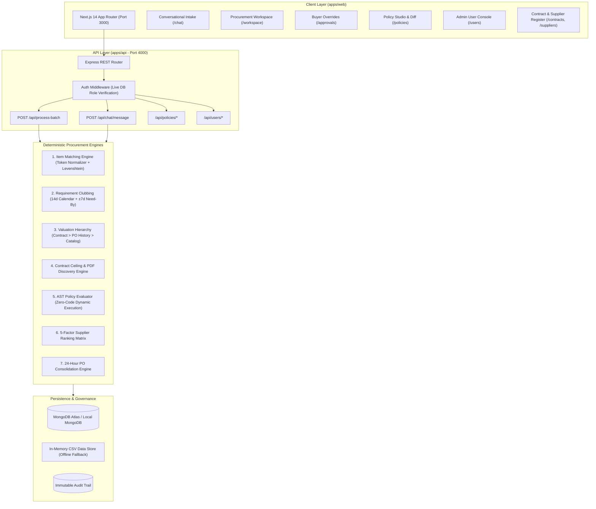

# Corvo Procurement Intelligence

Corvo Procurement Intelligence is an enterprise procurement management and decision automation platform built for the Cantill.ai Full-Stack Coding Challenge. It automates the evaluation of employee purchase requisitions against organizational procurement policies, clubs related items across manufacturing plants, evaluates active rate contracts, ranks preferred suppliers using historical supplier performance data, and generates auditable purchase orders or sourcing requests.

---

## Evaluation Demo Accounts — Not for Production

> [!WARNING]
> **These credentials are provided only for evaluation purposes. They must not be reused in a production environment. The demo accounts should be isolated from any personal or business database.**
>
> In a production deployment, initial administrative credentials must be provisioned via high-entropy environment variables (`INITIAL_ADMIN_PASSWORD`), rotated immediately after first boot, and managed exclusively through the authenticated User Management console.

The seeded evaluation database includes two pre-configured accounts representing the system's role-based access tiers:

| Role | Email | Password | Access Scope |
| :--- | :--- | :--- | :--- |
| **Administrator** | `admin@corvo.internal` | `admin1234` | Full system access: User provisioning, role assignment, credential resets, account deactivation, policy approval and activation, audit log inspection, and all procurement capabilities. |
| **Buyer** | `buyer@corvo.internal` | `buyer1234` | Operational procurement access: Batch CSV ingestion, chat-based PR intake, requisition workspace, manual decision overrides with justification comments, rate contract and supplier inspection. |

---

## Project Overview

In industrial organizations, managing thousands of purchase requisitions across multiple operating plants often leads to operational bottlenecks, split orders that miss volume discounts, accidental rate contract ceiling overruns, and non-compliant purchasing routes. 

Corvo Procurement Intelligence solves these challenges through a centralized, policy-driven intake and decision engine:

1. **Employees** submit purchase requests either through an interactive conversational chat interface (natural language) or via bulk CSV batch uploads from plant ERP systems.
2. **The Decision Engine** matches unstructured item descriptions to the catalog, clubs requisitions within a 14-day calendar window (±7-day need-by proximity), computes group valuations against contract and historical rates, evaluates rate contract validity and financial ceilings, and executes procurement policy rules using a pure Abstract Syntax Tree (AST) evaluator.
3. **Buyers** review automated decisions in a specialized workspace, inspect item-level breakdowns and supplier ranking scorecards, approve orders, or override routing decisions with mandatory audit-logged justification comments.
4. **Administrators** control governance: provisioning users (zero public self-registration), updating rate contracts, uploading amended procurement policy circulars, reviewing automated policy diffs, and activating new policy versions without code changes or service restarts.

---

## Key Features

The following capabilities are implemented and verified in the codebase:

- **Chat-Based Purchase Request Creation**: Conversational natural-language requisition intake with entity extraction (item, quantity, plant, need-by date, estimated price, urgency) and interactive clarification when mandatory fields are omitted.
- **CSV Batch Processing**: High-throughput processing endpoint (`POST /api/process-batch`) that ingests multi-line PR files, validates schemas, executes the 7-stage procurement pipeline, and returns structured JSON or direct CSV output.
- **Policy-Driven Decisions (Policy-as-Data)**: Abstract Syntax Tree (AST) condition evaluator that interprets procurement rules stored as versioned JSON documents, completely decoupling business policy from application code.
- **Versioned Procurement Policies**: Support for multiple concurrent policy versions (`v5.0`, `v5.1`) with activation state management, effective dates, and side-by-side visual diffing.
- **Policy Amendment Upload & Approval**: Administrators can upload amended policy documents (PDF or plain text). The platform extracts rule modifications, computes rule-level differences, and requires explicit Administrator approval before activating.
- **Hybrid Item Matching**: Multi-stage resolution for free-text requisition descriptions using exact code lookup, engineering abbreviation expansion (`brg` &rarr; `ball bearing`, `hyd` &rarr; `hydraulic`, `pneu` &rarr; `pneumatic`), model-number invariance (e.g., `6308`, `50:1`), and Levenshtein token similarity. Automatically isolates uncataloged items as `NEW_ITEM_SOURCING`.
- **Requirement Clubbing**: Groups requisitions for the same catalog item and plant within a 14-day calendar window, provided lines fall within a ±7-day need-by proximity. Requisitions marked `EMERGENCY` are segregated into dedicated groups to avoid delaying critical maintenance.
- **5-Factor Supplier Ranking**: Evaluates and ranks active suppliers per catalog item using a calibrated mathematical matrix combining PO Frequency (25%), Order Recency (25%), Contract History (15%), On-Time Delivery Percentage (20%), and Quality Rating (15%), with a strict four-level tie-breaking hierarchy.
- **Contract & Historical PO Valuation**: Priority valuation hierarchy (Active Rate Contract &rarr; Lowest 365-Day Historical PO Rate &rarr; Master Catalog Price &rarr; Requester Estimate). Enforces real-time financial ceiling tracking across batch runs and falls back to historical pricing when ceilings are exceeded.
- **Signed Contract PDF Discovery**: In addition to standard CSV contracts, the backend parses signed contract PDFs (`RC-2026-031` and `RC-2026-033`), dynamically registering supplier rates and value ceilings.
- **Procurement Routing**: Deterministic policy assignment to Spot PO, Contract PO, Emergency PO, Sourcing Requests (RFQ/RFP), Capex Sourcing, or New Item Sourcing based on financial thresholds and contract availability.
- **24-Hour Purchase Order Consolidation**: Automatically consolidates multiple requirement groups destined for the same supplier, plant, and procurement route within a 24-hour window under a single Purchase Order number (`PO-YYYY-NNNN`).
- **Buyer Workspace & Overrides**: Comprehensive operational interface for inspecting requirement groups, viewing supplier ranking scorecards, and submitting manual decision overrides with mandatory written justifications.
- **Role-Based Access Control (Option B)**: Enterprise security model with strictly Admin-controlled user provisioning, role assignments (`ADMIN` vs. `BUYER`), password management, account deactivation, and zero public registration.
- **Immutable Governance Audit Logging**: Comprehensive audit trail recording user logins, administrative changes, policy amendments, and manual decision overrides with actor IDs, timestamps, and payload diffs.
- **Preferred Supplier CSV Export**: Automated generation of `corvo__preferred.csv` ranking top suppliers across all catalog items, alongside `corvo__run1.csv` (Policy v5.0) and `corvo__run2.csv` (Amended Policy v5.1).

---

## Technology Stack

### Frontend (`apps/web`)
- **Framework**: Next.js 14 (App Router)
- **UI Library**: React 18, TypeScript (Strict Mode)
- **Styling**: Tailwind CSS, Tailwind Merge, CLSX
- **State & Data Fetching**: TanStack React Query v5
- **Icons & Motion**: Lucide React, Framer Motion
- **Validation**: Zod, React Hook Form

### Backend (`apps/api`)
- **Runtime & Server**: Node.js v20+, Express 4, TypeScript
- **Database & ODM**: MongoDB (Atlas / Local 5.0+) with Mongoose 8
- **Authentication**: JSON Web Tokens (`jsonwebtoken`), Bcrypt password hashing (`bcryptjs`, 12 rounds)
- **File Processing**: Multer (in-memory storage buffer), `csv-parse`, `csv-stringify`, `pdf-parse`
- **Validation**: Zod schema validation on all inputs and API boundaries

### Shared Packages (`packages/`)
- `@corvo/shared-types`: Canonical TypeScript interfaces for requisitions, requirement groups, contracts, suppliers, purchase orders, and audit logs.
- `@corvo/policy-schema`: Zod validation schemas and AST condition types for versioned procurement policies.

### Tooling & Infrastructure
- **Package Manager**: PNPM Workspaces (monorepo architecture)
- **Test Runner**: Vitest (15 test suites, 103 tests)
- **Process Orchestration**: Concurrently, TSX
- **Containerization**: Docker, Docker Compose

---

## System Architecture



---

## Local Setup

### Prerequisites
- **Node.js**: v20.0.0 or higher
- **PNPM**: v9.0.0 or higher (`npm install -g pnpm`)
- **MongoDB**: Local MongoDB instance running on port `27017` or a MongoDB Atlas connection URI
- **Git**

### 1. Clone & Navigate
```bash
git clone https://github.com/jatinsharma2005/corvo-procurement-intelligence.git
cd corvo-procurement-intelligence/corvo-procurement
```

### 2. Install Dependencies
```bash
pnpm install
```

### 3. Build Shared Workspace Packages
The API and Web applications depend on shared packages. Build them first:
```bash
pnpm build:packages
```

### 4. Configure Environment
Copy the example environment configuration:
```bash
# On Linux / macOS:
cp .env.example .env

# On Windows PowerShell:
Copy-Item .env.example .env
```
Ensure `MONGODB_URI` points to your local MongoDB or Atlas cluster. For local evaluation, the default values in `.env.example` connect to `mongodb://127.0.0.1:27017/corvo_procurement`.

### 5. Seed Database
Seed initial master items, suppliers, rate contracts, purchase history, Policy v5.0, and initial user accounts:
```bash
pnpm seed
```

### 6. Start Development Servers
You can run both the API and Web applications concurrently:
```bash
pnpm dev
```
Alternatively, run them in separate terminal windows:
```bash
# Terminal 1: Start Express API (Port 4000)
pnpm dev:api

# Terminal 2: Start Next.js Frontend (Port 3000)
pnpm dev:web
```
Access the application at **[http://localhost:3000](http://localhost:3000)**.

### 7. Production Build & Run
To compile and test production builds locally:
```bash
# Build all packages, API, and Next.js frontend
pnpm build

# Start the compiled API server
pnpm start:api

# Start the compiled Next.js server (in a separate terminal)
pnpm start:web
```

### 8. Containerized Execution (Docker Compose)
To run the full stack (MongoDB, API, and Frontend) inside containers:
```bash
docker-compose up --build
```
This automatically initializes MongoDB on port `27017`, the API on port `4000`, and the Web frontend on port `3000`.

---

## Environment Variables

The project uses `.env.example` as the source of truth for all required configuration keys. Never commit `.env` files containing real secrets to version control.

| Variable | Required In | Purpose | Example / Default |
| :--- | :---: | :--- | :--- |
| `NODE_ENV` | API | Application execution mode | `production` or `development` |
| `PORT` | API | HTTP port for Express server | `4000` (Local) / `10000` (Render) |
| `MONGODB_URI` | API | MongoDB connection string | `mongodb://127.0.0.1:27017/corvo_procurement` |
| `JWT_SECRET` | API | High-entropy secret key for signing JWTs | High-entropy 32+ character string |
| `JWT_EXPIRES_IN` | API | Session validity duration | `8h` |
| `CORS_ORIGIN` | API | Allowed frontend origins (comma-separated) | `http://localhost:3000` |
| `INITIAL_ADMIN_EMAIL` | API | Default administrative email for seed | `admin@corvo.internal` |
| `INITIAL_ADMIN_PASSWORD` | API | Initial administrative password for seed | Secure password string |
| `INITIAL_BUYER_EMAIL` | API | Default buyer email for seed | `buyer@corvo.internal` |
| `INITIAL_BUYER_PASSWORD` | API | Initial buyer password for seed | Secure password string |
| `NEXT_PUBLIC_API_URL` | Web | Base URL of the backend API for client requests | `http://localhost:4000/api` |
| `AI_PROVIDER` | API | Optional AI integration provider | `fallback`, `gemini`, or `openai` |
| `GEMINI_API_KEY` | API | Optional API key for Google Gemini intake | Optional |
| `OPENAI_API_KEY` | API | Optional API key for OpenAI intake | Optional |

---

## API Documentation

All API endpoints are prefixed with `/api`. Protected routes require a valid Bearer token in the `Authorization` header (`Authorization: Bearer <token>`).

### Endpoint Summary

| Method | Endpoint | Auth | Role | Description |
| :--- | :--- | :---: | :---: | :--- |
| `GET` | `/api/health` | No | Any | System health check and database connectivity status. |
| `POST` | `/api/auth/login` | No | Any | Authenticates email and password; returns JWT token and user info. |
| `GET` | `/api/auth/me` | Yes | Any | Returns profile and verified database role of current session. |
| `POST` | `/api/auth/logout` | Yes | Any | Invalidates current session and records audit event. |
| `POST` | `/api/process-batch` | Yes | Any | Core batch processing endpoint for PR CSV files. |
| `POST` | `/api/chat/message` | Yes | Any | Natural-language purchase request conversational intake. |
| `GET` | `/api/procurement/decisions` | Yes | Any | Fetches procurement decisions with filtering and pagination. |
| `POST` | `/api/procurement/decisions/:id/override` | Yes | Any | Submits a manual buyer override with mandatory comment. |
| `GET` | `/api/policies` | Yes | Any | Lists all policy versions and identifies the currently active version. |
| `POST` | `/api/policies/upload` | Yes | Any | Uploads a policy amendment document for AST parsing and diffing. |
| `POST` | `/api/policies/:version/approve` | Yes | `ADMIN` | Approves and immediately activates a proposed policy version. |
| `GET` | `/api/contracts` | Yes | Any | Returns all active rate contracts and remaining financial ceilings. |
| `POST` | `/api/contracts/upload` | Yes | `ADMIN` | Uploads and extracts signed contract rate agreements from PDF files. |
| `GET` | `/api/suppliers/rankings` | Yes | Any | Returns 5-factor preferred supplier rankings for catalog items. |
| `GET` | `/api/users` | Yes | `ADMIN` | Lists all provisioned user accounts (Buyers cannot access). |
| `POST` | `/api/users` | Yes | `ADMIN` | Provisions a new user account with assigned role. |
| `PATCH` | `/api/users/:id` | Yes | `ADMIN` | Modifies user details, role, or active status. |
| `POST` | `/api/users/:id/reset-password` | Yes | `ADMIN` | Resets a user's password to a secure temporary password. |
| `GET` | `/api/audit` | Yes | `ADMIN` | Retrieves immutable system audit logs. |
| `GET` | `/api/export/:type` | Yes | Any | Downloads submission CSVs (`run1`, `run2`, `preferred`). |

---

### Batch Processing Endpoint: `POST /api/process-batch`

The primary automated intake endpoint evaluates complete PR batches according to active policy rules.

- **URL**: `POST /api/process-batch`
- **Content-Type**: `multipart/form-data` (uploading a `.csv` file) or `application/json` (providing `{ "csvContent": "..." }`)
- **Headers**:
  - `Accept: application/json` (returns detailed JSON decision response)
  - `Accept: text/csv` (streams back the processed 13-column decision CSV)

#### cURL Request Example
```bash
curl -X POST http://localhost:4000/api/process-batch \
  -H "Authorization: Bearer <TOKEN>" \
  -H "Accept: application/json" \
  -F "file=@sample_pr_batch.csv"
```

#### JSON Response Schema (Excerpt)
```json
{
  "success": true,
  "batch_id": "BATCH-1731853200",
  "policy_version": "v5.0",
  "summary": {
    "total_pr_lines": 186,
    "total_requirement_groups": 104,
    "total_purchase_orders": 47,
    "total_sourcing_requests": 57,
    "total_procurement_value_inr": 28450120.45
  },
  "csv_rows": [
    {
      "pr_no": "PR-26-00001",
      "pr_line": 1,
      "resolved_item_code": "ITM-1011",
      "group_id": "GRP-PUN1-ITM-1011-20261108",
      "po_id": "PO-2026-0001",
      "decision": "PO",
      "route": "CONTRACT_PO",
      "supplier_id": "S001",
      "unit_price": 547.45,
      "group_value_inr": 82117.50,
      "suggested_supplier_ids": "",
      "policy_version": "v5.0",
      "reason": "Contract RC-2026-001 valid and ceiling available."
    }
  ]
}
```

---

## Testing & Verification

The test suite covers unit logic, end-to-end integration flows, and complete regression against all 14 worked procurement examples and 3 supplier ranking examples from the task specification.

### Run Tests
```bash
pnpm test
```

### Verified Test Results
- **15 Test Suites Passed (15/15)**
- **103 Tests Passed (103/103)**
- **0 Failures, 0 Regressions**

```
Test Files  15 passed (15)
     Tests  103 passed (103)
  Duration  ~12s
```

#### Test Suite Breakdown
1. **Unit Tests (`tests/unit/`)**:
   - `item-matching.test.ts`: Exact code lookup, token-level normalizer, technical abbreviation expansion, and uncataloged item classification.
   - `clubbing.test.ts`: 14-day calendar grouping, plant segregation, ±7-day need-by proximity, and emergency requisition isolation.
   - `contracts.test.ts`: Validity horizon checks, supplier status validation, financial ceiling tracking, and overflow fallback.
   - `policy-as-data.test.ts`: Pure JSON AST condition evaluation, nested logical predicates, and zero-code policy evaluation.
   - `policy-threshold-boundaries.test.ts`: Strict boundary verification (Spot PO < ₹2L, Emergency PO ≤ ₹5L, RFQ < ₹10L, RFP ≥ ₹10L).
   - `supplier-ranking.test.ts`: 5-factor mathematical matrix calibration replicating Worked Examples 1, 2, and 3.
   - `po-consolidation.test.ts`: 24-hour supplier, plant, and route PO number aggregation.
2. **Integration Tests (`tests/integration/`)**:
   - `batch-processing.test.ts`: Full 186-line sample PR batch evaluation against Policy v5.0.
   - `api-endpoints.test.ts`: Comprehensive verification of REST endpoints, status codes, and error formatting.
   - `contract-pdf-extraction.test.ts`: Real extraction of rate contracts `RC-2026-031` and `RC-2026-033` from signed PDF files.
   - `policy-amendment-workflow.test.ts`: End-to-end amendment parsing, diff generation, and administrative activation.
   - `chat-intake.test.ts`: Natural language requisition parsing and interactive field collection.
   - `user-management-rbac.test.ts`: Option B security verification (Admin user provisioning, Buyer restrictions, token validation).
   - `mongodb-persistence.test.ts`: Live database connection, model schema validation, and persistence across runs.
3. **Regression Tests (`tests/regression/`)**:
   - `worked-examples.test.ts`: Strict verification against all 14 official worked examples from the challenge specification.

---

## Production Deployment

The platform is designed for cloud deployment across decoupled frontend, backend, and database tiers:

- **Frontend**: Deployed on [Vercel](https://vercel.com) using Next.js 14 App Router. Requires setting `NEXT_PUBLIC_API_URL` to point to the backend API.
- **Backend**: Deployed on [Render](https://render.com) as a Node.js Web Service running `pnpm start:api`. Health checks are monitored via `GET /api/health`.
- **Database**: Managed [MongoDB Atlas](https://www.mongodb.com/atlas) cluster with TLS encryption, automated backups, and secure connection string management.

For complete step-by-step instructions, build configurations, and post-deployment verification procedures, refer to [DEPLOYMENT.md](file:///c:/Users/ns448/OneDrive/Desktop/cellint.ai/Cantill_FullStack_Task_Kit/corvo-procurement/DEPLOYMENT.md).

---

## Project Structure

```
corvo-procurement/
├── apps/
│   ├── api/                              # Express REST API backend
│   │   ├── src/
│   │   │   ├── config/                   # Environment configuration & secrets
│   │   │   ├── engines/                  # Deterministic procurement decision engines
│   │   │   │   ├── contract-evaluation.ts
│   │   │   │   ├── item-matching.ts
│   │   │   │   ├── po-consolidation.ts
│   │   │   │   ├── policy-engine.ts
│   │   │   │   ├── requirement-clubbing.ts
│   │   │   │   ├── supplier-ranking.ts
│   │   │   │   └── valuation.ts
│   │   │   ├── middleware/               # Auth & RBAC middleware
│   │   │   ├── models/                   # Mongoose data models
│   │   │   ├── routes/                   # API route handlers
│   │   │   ├── scripts/                  # DB seed & password reset CLI
│   │   │   ├── services/                 # Business logic & data access services
│   │   │   └── server.ts                 # Express application entry point
│   │   └── package.json
│   └── web/                              # Next.js 14 App Router frontend
│       ├── src/
│       │   ├── app/                      # App router page routes
│       │   │   ├── approvals/            # Buyer override interface
│       │   │   ├── audit/                # Immutable audit log viewer
│       │   │   ├── chat/                 # Natural language conversational intake
│       │   │   ├── contracts/            # Rate contract register & PDF discovery
│       │   │   ├── dashboard/            # Executive procurement metrics
│       │   │   ├── login/                # Authentication page
│       │   │   ├── policies/             # Policy Studio & AST diff viewer
│       │   │   ├── suppliers/            # Supplier rankings & performance
│       │   │   ├── users/                # Admin user management console
│       │   │   └── workspace/            # Procurement workspace & batch processor
│       │   ├── components/               # Reusable UI components & layouts
│       │   └── lib/                      # API client & utility functions
│       └── package.json
├── packages/
│   ├── policy-schema/                    # Shared Zod schemas for Policy AST
│   └── shared-types/                     # Shared TypeScript data models
├── submission/                           # Official submission CSV artifacts
│   ├── corvo__preferred.csv              # Top 3 ranked suppliers per catalog item
│   ├── corvo__run1.csv                   # 186-line batch decisions under Policy v5.0
│   └── corvo__run2.csv                   # 186-line batch decisions under Policy v5.1
├── tests/                                # Vitest test suites (103 tests)
│   ├── integration/                      # API, DB, and batch integration tests
│   ├── regression/                       # Worked examples regression tests
│   └── unit/                             # Engine-specific unit tests
├── .env.example                          # Canonical environment configuration template
├── APPROACH.md                           # Detailed engineering architecture & approach
├── DECISIONS.md                          # Architecture Decision Records (ADRs)
├── DEPLOYMENT.md                         # Production deployment walkthrough
├── docker-compose.yml                    # Local multi-container development configuration
├── package.json                          # Monorepo root scripts & devDependencies
└── pnpm-workspace.yaml                   # PNPM workspace definition
```

---

## Submission Artifacts

The required evaluation CSV artifacts are located in `submission/`:
- `submission/corvo__run1.csv`: 186 purchase requisition lines evaluated under Corvo Procurement Policy v5.0.
- `submission/corvo__run2.csv`: 186 purchase requisition lines evaluated under Amended Policy v5.1.
- `submission/corvo__preferred.csv`: Ranked preferred suppliers for catalog items based on historical performance.

These artifacts can be regenerated at any time using:
```bash
pnpm generate-submission
```
